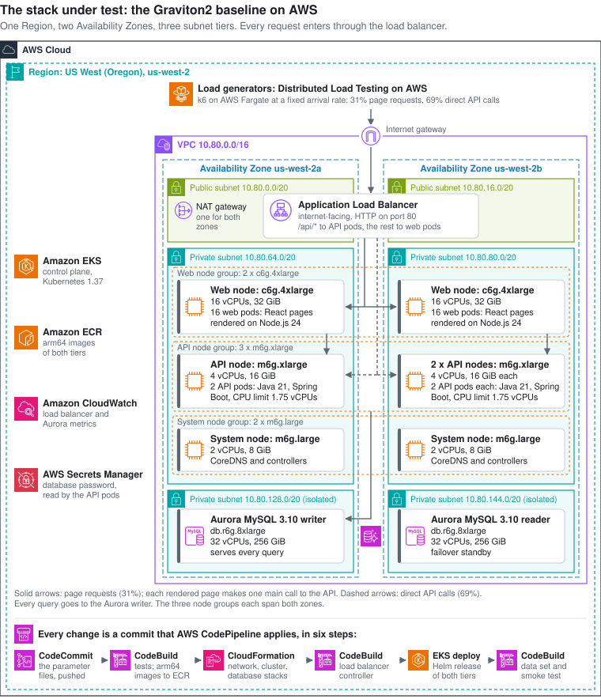
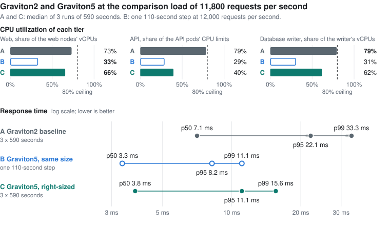

# Graviton2 to Graviton5: rated at 80% CPU utilization, right-sized, measured

What happens to performance and cost when a three-tier stack on AWS moves from Graviton2 to Graviton5, and whether a Graviton5 stack of half the size carries the load the Graviton2 stack is rated for. The stack is a synthetic storefront: React pages rendered on Node.js and a Java API, both on Amazon EKS, with Amazon Aurora MySQL behind them.

The method has four steps:

1. **Rate the baseline.** Find the request rate at which the busiest tier of the Graviton2 stack is at 80% CPU utilization. That rate is the load to carry, unless you know your peak to be lower.
2. **Upgrade at the same size,** and measure the CPU time each request costs on Graviton5.
3. **Work backwards** from the rated load to the CPU each tier needs, and from there to an instance size.
4. **Run both stacks at the rated load,** and compare response time, errors, CPU utilization, headroom and cost.

The study was not run in that order. The half-size configuration was fixed before any run on Graviton5, the 80% rule was added during the first session, and step 3 checks the sizes: it did not choose them. `docs/02-experiment-protocol.md` records what was decided when.

This repository holds the application, the infrastructure, the pipeline, the load test, the analysis and the recorded results of the three configurations. The study is written up on TutLinks.com: [Graviton2 to Graviton5: Right-Sized, 44% Instance Savings](https://tutlinks.com/graviton2-to-graviton5-upgrade/).



## Results

One workload, one AWS Region (us-west-2), two sessions on 23 and 24 November 2026.

<!-- results: built from report/readme-results.md by analysis/readme.py; do not edit here -->
|  | **A: Graviton2 baseline** | **B: Graviton5, same size** | **C: Graviton5, right-sized** |
|---|---:|---:|---:|
| Web nodes<br>API nodes<br>Aurora MySQL instances | 2 x `c6g.4xlarge`<br>3 x `m6g.xlarge`<br>2 x `db.r6g.8xlarge` | 2 x `c9g.4xlarge`<br>3 x `m9g.xlarge`<br>2 x `db.r9g.8xlarge` | 2 x `c9g.2xlarge`<br>3 x `m9g.large`<br>2 x `db.r9g.4xlarge` |
| CPU utilization of the busiest tier at the comparison load of 11,800 requests per second; the API tier's is a share of its pods' CPU limits | 79%, database writer (API tier: 79%) | 33%, web tier, at 12,000 requests per second ¹ | 66%, web tier |
| p99 response time at the comparison load of 11,800 requests per second | 33.3 ms | 11.1 ms, at 12,000 requests per second ¹ | 15.6 ms |
| Rated load: the request rate at 80% CPU utilization, from each configuration's ceiling run | about 11,900 requests per second | about 28,400 requests per second | about 14,900 requests per second |
| EC2 and Aurora instances, On-Demand | $7,307 per month | $8,067 per month (+10% against A) | $4,105 per month (-44% against A) |
| Modelled bill of the stack, On-Demand, at an average of 4,000 requests per second: the items listed in `report/tables/bom-on-demand.md` | $12,354 per month | $13,145 per month (+6% against A) | $9,206 per month (-25% against A) |

¹ Configuration B was not run at 11,800 requests per second. Its figures are from one 110-second step of its capacity run, at 12,000 requests per second, and are shown for reference.



- **The baseline's rated load.** The Graviton2 stack reaches 80% CPU utilization at about 11,900 requests per second. The stacks are compared at 11,800 requests per second, the rate of the run that gave that rating.
- **Same size, new generation (B).** At 8,000 requests per second each tier spends 55% to 64% less CPU time per request. The instances cost 10% more at On-Demand prices, because a Graviton5 instance costs more than the Graviton2 instance of the same size.
- **Half the size (C).** At 11,800 requests per second the busiest tier of the right-sized stack is at 66% CPU utilization and its p99 response time is 15.6 ms, against 79% CPU utilization and a p99 response time of 33.3 ms on the baseline, on half the vCPUs of the web, API and database tiers. Its instances cost 44% less at On-Demand prices.
- **Where the saving is, and what commitments do to it.** Of the $3,202 per month saved on instances, $2,823 per month is the two Aurora instances. With fresh one-year commitments where AWS returned a rate, the right-sized stack's instances cost 20% less, not 44%: no Reserved Instance rate came back for the new `db.r9g` class.
- **Headroom.** By its ceiling run in the first session, the right-sized stack reaches 80% CPU utilization at about 14,900 requests per second. Its runs in the second session, scaled further than the rule allows for a rating, point to about 14,400 requests per second.
- **One web node out of service.** With one of its two web nodes taken out of service before the run, the right-sized stack carried 8,000 requests per second without a failed request, with the remaining node at 89% CPU utilization and a p99 response time of 38.7 ms instead of 11.8 ms. At 11,800 requests per second one web node would need 131% of its vCPUs on the right-sized stack and 146% on the baseline, by arithmetic; that was not run.
- **The cost of changing.** A pipeline applied the upgrade and the right-sizing under a background load of 4,000 requests per second in about 35 and 40 minutes. No probe request failed while the nodes were replaced. The failed probe requests, 1,936 in the upgrade and 2,525 in the right-sizing, came in clusters at the two database failovers of each change, with up to 24 seconds without a successful response. Of the background load's requests, 0.31% failed over the hour in which the upgrade was observed and 0.51% over the hour of the right-sizing.
<!-- /results -->

The bills are models built from On-Demand list prices and an assumed average traffic, not invoices. An 80% rating is not a safe peak: by arithmetic, two web nodes that each run above 50% CPU utilization cannot carry their load on one. `docs/02-experiment-protocol.md` has the limits that were fixed in advance (section 11) and everything that deviated from the plan; read them before you use a number.

## What is in the repository

| Path | Content |
|---|---|
| `app/api`, `app/web` | The storefront: a Spring Boot API (Java 21) and React pages rendered by Node.js 24 |
| `infra/cfn` | Four CloudFormation templates: pipeline, network, EKS cluster, Aurora cluster |
| `infra/stages`, `infra/config` | The parameter files of the three configurations, and the active one, which the pipeline deploys |
| `ci`, `deploy` | CodeBuild build specifications and scripts, the Helm chart, the job that loads the data set |
| `loadtest` | The k6 workload and its request mix |
| `scripts` | Bootstrap, configuration changes, benchmark sequences, recordings, parking; `scripts/phases` holds the scripts that ran the later phases of both sessions |
| `tools` | The benchmark runner for Distributed Load Testing on AWS (`bench.py`), its latency histograms (`dlthist.py`), the record per second of a probe (`timeline.py`), the recorders of a configuration change (`inventory.py`, `change_events.py`) and the replacement of account identifiers (`redact.py`) |
| `analysis` | Run summaries, the comparison, the 80% CPU ceiling, the comparison at the rated load, the price snapshot and the bill, tables, charts, architecture diagrams, and the results above (`readme.py`) |
| `results` | Every retained run of the three configurations (`config.json`, `dlt.json`, `cloudwatch.json`, `database.json`, `kubelet.jsonl`, `summary.json` and the `workload.js` it ran), the environment and the recordings of each configuration (`environment*.json`, `evidence/`), what was recorded during the two observed changes (`*-events.json`, `*-inventory.jsonl`, `*-kubernetes-events.json`, `*-summary.json`, `ab-api-logs/`), the recordings of the study as a whole (`results/evidence/`), the price snapshot, the usage figures (`usage.json`), and the computed comparison, ceiling, rated-load comparison and bill |
| `report` | What the analysis writes: the tables (`tables/*.md`) and the figures (`figures/*.svg`). Also the source of the results above (`readme-results.md`) and the AWS Architecture Icons the diagrams use |
| `docs` | Research notes, and the experiment protocol with its additions and deviations |

## Rebuild the numbers from the recorded runs

This needs no AWS account. It needs `bash`, `git`, [`uv`](https://docs.astral.sh/uv/) (which fetches Python 3.11 or later from the network if you have none), `jq` and the usual Unix tools (`awk`, `grep`, `sort`, `column`).

```
SKIP_AWS=1 scripts/build-report.sh
```

It summarizes every run again, recomputes the comparison, the ceiling, the comparison at the rated load and the bill, and regenerates the tables, the charts, the architecture diagrams, the analysis listings and the results section of this README. `git diff` then shows whether anything came out differently. If an analysis command fails, the build stops and its listing is left as it was.

The build reads three recorded inputs and does not renew them with `SKIP_AWS=1`: the CloudWatch graphs, the usage figures of the first session (`results/usage.json`) and the price snapshot. Without `SKIP_AWS=1` it reads the usage metrics and draws the CloudWatch graphs again. That is for runs of your own, in the account that made them and while it still holds their metrics: the published runs name their instances by placeholders, so for them it stops and leaves the recorded usage file as it is. The price snapshot is renewed only by `uv run analysis/pricing.py`.

To look at single results:

```
uv run analysis/summarize.py results/c-graviton5-right-sized/c2-rated-1   # one run
uv run analysis/compare.py                                                # the three configurations at 8,000 requests per second
uv run analysis/ceiling.py                                                # the rated load of each at 80% CPU utilization
uv run analysis/rated.py                                                  # the comparison at 11,800 requests per second, the rate of the baseline's ceiling run
uv run analysis/bom.py                                                    # the bill
```

The console logs under each configuration's `evidence/` directory (`benchmark*.log`, `ceiling*.log`) are what the tools printed while the runs were made. Their column `api%` gives the API tier's CPU as a share of its nodes' vCPUs, as do the lines per tier in `results/evidence/analysis/comparison.txt`. The columns headed `%limit` in the other analysis listings give it as a share of the pods' CPU limits, which is the measure of the 80% rule, and so do the tables, in words.

## Run the study again

A new run costs money. The modelled monthly bills in `results/bom.json`, divided by 730 hours, come to about $13 to $18 per hour for the three configurations at On-Demand list prices. That is not a forecast of what a run costs: it leaves out the load generators, up to 110 Fargate tasks in a capacity run, and it prices traffic at the model's average. You need:

- an AWS account in US West (Oregon), with quota for 32-vCPU Aurora instances and about 220 Fargate vCPUs. The templates, the price snapshot and the bill are written for that Region; elsewhere you need the C9g and M9g instance families, the `db.r9g` Aurora classes, the zones in `infra/cfn/network.yaml` and a price snapshot of your own;
- [Distributed Load Testing on AWS](https://aws.amazon.com/solutions/implementations/distributed-load-testing-on-aws/) deployed in that Region (the study used version 4.3.4 with k6 1.5.0);
- `uv`, the AWS CLI, `kubectl`, `jq`, `git`, `python3` and `column` on Linux (the scripts use GNU `date -d` and `xargs -a`).

A new run writes new evidence. Start from a copy in which the recorded runs are removed (`results/calibration`, `results/[a-c]-*` and `results/evidence`), because the benchmark tool refuses to overwrite a run that exists. The price snapshot in `results/pricing/` stays as it is, dated 23 November 2026, unless you renew it with `uv run analysis/pricing.py`.

```
# Run it command by command and stop at the first command that fails. With pipefail, a
# benchmark that fails shows through `tee`.
set -o pipefail
export AWS_PROFILE=my-profile AWS_REGION=us-west-2 DLT_STACK=my-dlt-stack

# Once: the IAM role that administers the cluster (the repository ships a placeholder), then
# the repository, container registries and pipeline. The push starts the pipeline, which
# creates the network, the cluster and the database, deploys the baseline and loads the data.
scripts/set-admin-role.sh
scripts/bootstrap.sh
scripts/pipeline-status.sh                      # shows the state once: repeat until every stage has succeeded
aws eks update-kubeconfig --name graviton-uplift

# First session. Configuration A: the placement of the database writer (one API node in its
# zone; in this study it was there by chance), the deployed state, then warm-up, staircase and
# three runs at 8,000 requests per second. The console output of every sequence is kept with
# the evidence.
mkdir -p tmp
scripts/align-writer-zone.sh 1
scripts/snapshot-environment.sh
scripts/capture-evidence.sh deployed
scripts/run-stage-benchmarks.sh a 2>&1 | tee tmp/stage-a.log
mkdir -p results/a-graviton2-baseline/evidence
cp tmp/stage-a.log results/a-graviton2-baseline/evidence/benchmark.log

# The upgrade, observed under load, and the recordings of it. The last line that
# change-stage.sh prints gives the start and the end of the observation: put them in
# START and END (the two values below are placeholders).
BEFORE="$(git rev-parse HEAD)"
scripts/change-stage.sh b-graviton5-same-size ab "Upgrade every tier to Graviton5"
START="2026-01-01T00:00:00Z"; END="2026-01-01T01:00:00Z"
scripts/snapshot-environment.sh
scripts/capture-evidence.sh deployed
scripts/capture-change-evidence.sh "$BEFORE" HEAD "$START" "$END"
scripts/capture-failover-logs.sh a-graviton2-baseline ab

# B's runs and its ceiling run.
FACTORS=1.0,1.5,2.0,2.5,3.0,3.2,3.4,3.6,3.8,4.0 CAPACITY_TASKS=110 scripts/run-stage-benchmarks.sh b 2>&1 | tee tmp/stage-b.log
scripts/run-ceiling.sh b 2>&1 | tee tmp/ceiling-b.log
cp tmp/stage-b.log results/b-graviton5-same-size/evidence/benchmark.log
cp tmp/ceiling-b.log results/b-graviton5-same-size/evidence/ceiling.log

# The right-sizing with C's runs, and the baseline again with its ceiling run.
scripts/phases/c-right-sizing.sh
scripts/phases/a-again.sh

# Between the sessions the stack was parked. park.sh returns while the database is still
# stopping and the nodes are still leaving, and unpark.sh starts the database only if it
# is stopped: wait for both before it, and for the database and the pods after it.
scripts/park.sh
until [ "$(aws rds describe-db-clusters --db-cluster-identifier graviton-uplift \
    --query 'DBClusters[0].Status' --output text)" = stopped ]; do sleep 30; done
for group in $(aws eks list-nodegroups --cluster-name graviton-uplift --query nodegroups --output text); do
  aws eks wait nodegroup-active --cluster-name graviton-uplift --nodegroup-name "$group"
done
scripts/unpark.sh
aws rds wait db-cluster-available --db-cluster-identifier graviton-uplift
kubectl -n storefront wait --for=condition=Ready pods --all --timeout=900s

# Second session: both stacks at the rate of the ceiling run that rates the baseline, and
# one web node out of service. `uv run analysis/ceiling.py comparison` prints that rate and
# the number of load generator tasks for it, as RATE=... TASKS=...
# Without a baseline rating the second line prints an error and the third one stops.
unset RATE TASKS
eval "$(uv run -q analysis/ceiling.py comparison)"
RATE="${RATE:?no rating of the baseline}" TASKS="${TASKS:?no rating of the baseline}" scripts/phases/rated-load.sh
scripts/park.sh

# The CloudWatch graphs of each session, with your own start and end times (UTC), and then
# every table and figure, from the recorded runs.
SESSION1_START="2026-01-01T00:00:00Z"; SESSION1_END="2026-01-01T12:00:00Z"     # placeholders
SESSION2_START="2026-01-02T00:00:00Z"; SESSION2_END="2026-01-02T04:00:00Z"     # placeholders
scripts/capture-cloudwatch-images.sh session1 "$SESSION1_START" "$SESSION1_END"
scripts/capture-cloudwatch-images.sh session2 "$SESSION2_START" "$SESSION2_END"
scripts/build-report.sh
```

Things to know before you start:

- The stack is a benchmark target, not a service to keep. Its load balancer is open to the internet over HTTP, without authentication, and accepts the storefront's writes; the cluster's API endpoint is reachable from the internet with AWS credentials. Keep nothing of value in it, and park or remove it when you are done.
- `scripts/set-admin-role.sh` writes the ARN of your role, which contains your account ID, into the parameter files and commits it. The pipeline deploys what is committed to an AWS CodeCommit repository in your account (`scripts/push.sh`). Keep that clone private.
- The outline is a reconstruction, not a script that ran as a whole: the first phases were run command by command, the later ones with the scripts under `scripts/phases/`. It sets the placement of configuration A's database writer and records A's deployed state; this study found that placement by chance and began to record the deployed state only with configuration B.
- The comparison rate in `scripts/phases/rated-load.sh` (11,800 requests per second) is the rate of the run that rated this study's baseline. A new baseline needs its own: `uv run analysis/ceiling.py comparison` prints the rate of its ceiling run that counts (the repeat, if the first one missed the window of 75% to 85% CPU utilization), and `analysis/rated.py` stops if the later runs were made at another rate.
- The outline leaves out the calibration that fitted the request mix (`results/calibration/`) and the resize of the API tier before the official runs. `docs/02-experiment-protocol.md` has the method and everything that deviated from it.
- One setting in `analysis/bom.py` belongs to this study's runs and needs your own value: `IO_BLOCKS_LEFT_OUT`, the periods of the billed I/O metric that the bill leaves out.
- The build draws the CloudWatch graphs again only for the periods it finds in `results/evidence/cloudwatch/*.period.txt`, which `scripts/capture-cloudwatch-images.sh` writes.
- The last step builds the analysis, the tables, the figures and the results section of this README from your runs. That section's text (`report/readme-results.md`) is written for this study's runs: it names their rates and what they showed, and the build stops where it asks for a run that yours does not have. Write your own against your own results.
- `scripts/phases/c-right-sizing.sh` makes the change and runs C's benchmarks in one go, without checking the placement of the database writer relative to the API nodes. In this study the placement happened to be the baseline's, which was checked by hand. To have it in your run, split the script: after the change, record the change (`capture-change-evidence.sh`, `capture-failover-logs.sh`), then run `scripts/align-writer-zone.sh 1`, and only then record the environment and the deployed state (`snapshot-environment.sh`, `capture-evidence.sh deployed`) and run the benchmarks. A failover made by the alignment would otherwise leave recordings that name the wrong writer. The later phases keep that order themselves.
- The two checks on the load generators are reported, not enforced: after `analysis/compare.py`, `load_generators` in `results/comparison.json` says whether every task reported and how busy the busiest one was. Repeat a run that fails them, as the protocol says.
- The container images are built by the pipeline on base images that are not pinned by digest, so a rebuild can differ from the images that were measured.
- Your numbers will differ. The study is two sessions on two days, and repeats of the same configuration differed by a few percent.

### Stopping the cost

```
scripts/park.sh      # node groups to zero, Aurora cluster stopped; nothing is deleted
scripts/unpark.sh    # back to the sizes recorded in results/evidence/parked.json
```

A parked stack still pays for the EKS control plane, the NAT gateway, the load balancer and the Aurora volume, and AWS starts a stopped Aurora cluster again after seven days. Parking is not immediate: in this study the last nodes left about 16 minutes after `park.sh`, when the node groups' wait for pods to be evicted had run out. The `results/evidence/parked.json` in this repository records the study's own stack after its second session, with the node group names replaced by placeholders; `park.sh` writes a new one for your stack.

There is no teardown script. This study's stack was removed once, on 24 November 2026, after the study, with single API calls and without a recording like those of the runs. From the first call to the last stack it took about 21 minutes. What was done, in this order:

1. **Nodes and database first.** Delete the three node groups, then both database instances and the Aurora cluster without a final snapshot (`aws rds delete-db-cluster --skip-final-snapshot`). If the database stack deletes the cluster itself, it keeps a final snapshot (`DeletionPolicy: Snapshot` in `infra/cfn/database.yaml`). Nearly five minutes after the node groups' deletion began, five of the seven nodes were still running, waiting for their pods to be evicted; terminating the instances ended the wait. The Aurora cluster was gone within 15 minutes of its delete call.
2. **What the AWS Load Balancer Controller made.** CloudFormation does not know the load balancer `graviton-uplift`, its two target groups or the controller's two security groups (`k8s-storefro-...` and `k8s-traffic-...`). Delete them once the nodes are gone, so that the controller cannot make them again. One rule in the cluster's security group refers to a security group of the controller and has to be revoked first.
3. **The EKS cluster.** It was gone in under five minutes. Its own security group, `eks-cluster-sg-graviton-uplift-...`, was still in the VPC minutes later and was deleted by hand.
4. **The pipeline's artifact bucket.** Delete every version and every delete marker: the bucket is versioned, and its stack cannot be deleted while it holds any.
5. **The stacks,** each after the one before it is gone: `graviton-uplift-database`, `graviton-uplift-eks`, `graviton-uplift-network`, `graviton-uplift-cicd`. The first three are deleted with a role that the fourth owns, so the pipeline's stack goes last. CloudFormation accepted that the resources of steps 1 to 3 were already gone, and each stack was gone within two minutes.

What was still there after the stacks, and was deleted one by one:

- three log groups: `/aws/codepipeline/graviton-uplift`, `/aws/rds/cluster/graviton-uplift/error` and `/aws/rds/cluster/graviton-uplift/slowquery`;
- the Enhanced Monitoring records of the two database instances, one log stream each in the log group `RDSOSMetrics`;
- in Distributed Load Testing on AWS, which is a stack of its own and stays:
  - the test scenarios, which its API deletes (`DELETE /scenarios/<test ID>`);
  - the tests' objects in its scenarios bucket, under `results/`, `public/test-scenarios/`, `test-scenarios/` and `start-signal/`. That bucket is versioned: what `tools/bench.py delete-raw` deletes stays behind as noncurrent versions until those are deleted by version;
  - the log streams of the load generator tasks, which that solution keeps for ten years, and the log group `/aws/ecs/containerinsights/<its cluster>/performance`.

Not tried: removing the Helm release first (`helm uninstall storefront -n storefront`) on a stack that is not parked, so that the controller removes the load balancer itself. AWS keeps the record of a deleted stack for 90 days.

## Migrate your own stack

The [post](https://tutlinks.com/graviton2-to-graviton5-upgrade/) ends with a migration guide for a stack of your own. The scripts here are written for this study's stack: read them as worked examples of the guide's steps. This is what each one assumes:

| Step | Worked example | What it assumes |
|---|---|---|
| Rating a stack, and testing a size at the load it must carry | `tools/bench.py` with `loadtest/workload.js`, on [Distributed Load Testing on AWS](https://docs.aws.amazon.com/solutions/distributed-load-testing-on-aws/): a staircase of rising request rates, then 10-minute runs at a fixed arrival rate. `analysis/ceiling.py` computes the rating | The storefront of this repository, its namespace and its database stack. Before every run it deletes the orders that earlier runs wrote, and the request mix writes carts and orders: point it at nothing that holds data you need |
| CPU time per request, and the size each tier needs | `analysis/summarize.py` for one run, `analysis/rated.py` for the calculation | The names of this study's configurations and runs, and this study's rating as the load |
| Prices before any change | `analysis/pricing.py` reads the On-Demand, Savings Plans and Reserved Instance rates that AWS offers for the instance types in `infra/stages`; `analysis/bom.py` builds the bill from them | One of three Regions; two database instances; this study's traffic and I/O. It writes `results/pricing/<region>.json` and does not know the commitments you hold |
| Applying a change and watching clients during it | `scripts/change-stage.sh` with the parameter files under `infra/stages`; `tools/timeline.py` turns the probe into a record per second | This study's pipeline, to which it commits and pushes; a background load of 4,000 requests per second and a probe of 100 requests per second |

## What was changed for publication

- **Identifiers of the AWS account are replaced** in the recorded files (`tools/redact.py`): the account ID reads `<account-id>`, the administrator role `<admin-role>`, the load-testing stack `<dlt-stack>`. EC2 instance IDs, load generator task IDs, the generated suffixes in the names of database instances, node groups and target groups, the load balancer's DNS name and ID, the pipeline's execution IDs and other UUIDs are placeholders of the same length. The analysis gives the same numbers as on the original files. Node names and pod addresses are as recorded; they come from the address range in `infra/cfn/network.yaml`.
- **The repository is a single commit.** The commit hashes in the recordings and the protocol belong to two private histories that the pipeline deployed from, one for each session. They hold the account's identifiers and are not published. The order in which things were decided during the study can therefore not be checked from this repository.
- **Two parameters are placeholders.** The administrator role in the parameter files is set by `scripts/set-admin-role.sh`, and the tools take the name of the load-testing stack from `DLT_STACK`.

Details are in deviation 21 of `docs/02-experiment-protocol.md`. If you publish results of your own run, run `tools/redact.py` over them first.

## Disclaimer

This repository is the record of one study: one synthetic workload, one AWS Region, 23 and 24 November 2026. Your workload will give other numbers, so measure it before you act on these.

- **Prices and bills.** The prices are AWS list prices read on 23 and 24 November 2026 and can change. The bills are models, not invoices.
- **The cost and the exposure of trying it.** Deploying this repository creates AWS resources in your account. AWS bills you for them until you remove them, by the modelled bills about $13 to $18 per hour without the load generators, and a parked stack still costs money. Its load balancer is open to the internet over HTTP, without authentication. Removing the stack is manual, and log groups, bucket versions and the load-testing solution's data stay behind until they are deleted one by one (see "Stopping the cost").
- **No warranty.** The code and the data are provided as they are, without warranty of any kind and without support, on the terms of the [license](LICENSE).
- **How it was made.** An AI coding agent wrote the code and the documentation and ran the sessions under the author's direction, and other models reviewed the work.
- **Not an AWS project.** AWS has not endorsed it. AWS, Amazon EC2, Amazon EKS, Amazon Aurora and AWS Graviton are trademarks of Amazon.com, Inc. or its affiliates.

## License

[MIT](LICENSE), for the code, the recorded results and the texts of this repository, which were made under the author's direction with an AI coding agent. [NOTICE](NOTICE) lists what comes from others and keeps its own terms: the IAM policy of the AWS Load Balancer Controller and the histogram layout of Distributed Load Testing on AWS (both under the [Apache License 2.0](LICENSES/Apache-2.0.txt)), the AWS Architecture Icons in the diagrams, quotations and a table from AWS's documentation, the output of AWS services and of other software in the recordings, AWS's prices, and the software that the application and the tools depend on.

This is an independent study, not an AWS project.
