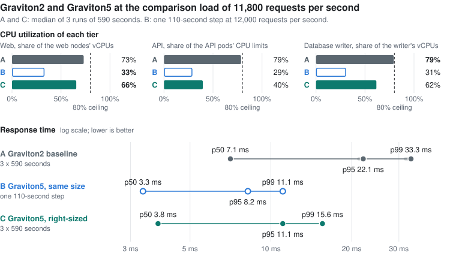

::include tables/summary.md

- **The baseline's rated load.** The Graviton2 stack reaches 80% CPU utilization at about {{a.ceiling.rated_rps|,.0f}} requests per second. The stacks are compared at {{rated.rate_rps|,.0f}} requests per second, the rate of the run that gave that rating.
- **Same size, new generation (B).** At {{b.steady.target_rps|,.0f}} requests per second each tier spends {{= 1 - 1 / b.cpu_per_request_vs_baseline.web |.0%}} to {{= 1 - 1 / b.cpu_per_request_vs_baseline.api |.0%}} less CPU time per request. The instances cost {{b.cost.compute_database_change|.0%}} more at On-Demand prices, because a Graviton5 instance costs more than the Graviton2 instance of the same size.
- **Half the size (C).** At {{rated.rate_rps|,.0f}} requests per second the busiest tier of the right-sized stack is at {{c.at_rated.busiest_utilization|.0%}} CPU utilization and its p99 response time is {{c.at_rated.latency_ms.p99.median|.1f}} ms, against {{a.at_rated.busiest_utilization|.0%}} CPU utilization and a p99 response time of {{a.at_rated.latency_ms.p99.median|.1f}} ms on the baseline, on half the vCPUs of the web, API and database tiers. Its instances cost {{= -c.cost.compute_database_change |.0%}} less at On-Demand prices.
- **Where the saving is, and what commitments do to it.** Of the {{= a.ceiling.cost.compute_database - c.ceiling.cost.compute_database |$}} per month saved on instances, {{= a.cost.aurora.instances - c.cost.aurora.instances |$}} per month is the two Aurora instances. With fresh one-year commitments where AWS returned a rate, the right-sized stack's instances cost {{= 1 - bom.stages["c-graviton5-right-sized"].committed.groups["Compute and database"] / bom.stages["a-graviton2-baseline"].committed.groups["Compute and database"] |.0%}} less, not {{= -c.cost.compute_database_change |.0%}}: no Reserved Instance rate came back for the new `db.r9g` class.
- **Headroom.** By its ceiling run in the first session, the right-sized stack reaches 80% CPU utilization at about {{c.ceiling.rated_rps|,.0f}} requests per second. Its runs in the second session, scaled further than the rule allows for a rating, point to about {{rated.right_sized_rating_from_second_session.rated_rps|,.0f}} requests per second.
- **One web node out of service.** With one of its two web nodes taken out of service before the run, the right-sized stack carried {{rated.one_web_node_out.target_rps|,.0f}} requests per second without a failed request, with the remaining node at {{rated.one_web_node_out.surviving_node_utilization|.0%}} CPU utilization and a p99 response time of {{rated.one_web_node_out.p99_ms|.1f}} ms instead of {{rated.one_web_node_out.both_nodes.p99_ms|.1f}} ms. At {{rated.rate_rps|,.0f}} requests per second one web node would need {{= 2 * c.at_rated.utilization.web.median |.0%}} of its vCPUs on the right-sized stack and {{= 2 * a.at_rated.utilization.web.median |.0%}} on the baseline, by arithmetic; that was not run.
- **The cost of changing.** A pipeline applied the upgrade and the right-sizing under a background load of {{changes.ab.background_load.rate|,.0f}} requests per second in about {{= round(changes.ab.pipeline_seconds / 60) }} and {{= round(changes.bc.pipeline_seconds / 60) }} minutes. No probe request failed while the nodes were replaced. The failed probe requests, {{changes.ab.probe.during_the_change.failed|,}} in the upgrade and {{changes.bc.probe.during_the_change.failed|,}} in the right-sizing, came in clusters at the two database failovers of each change, with up to {{= max(max(p.consecutive_seconds_without_a_success for p in changes.ab.probe.failure_periods), max(p.consecutive_seconds_without_a_success for p in changes.bc.probe.failure_periods)) }} seconds without a successful response. Of the background load's requests, {{changes.ab.background_load.share|.2%}} failed over the hour in which the upgrade was observed and {{changes.bc.background_load.share|.2%}} over the hour of the right-sizing.
